# [NOME] Engenharia Elétrica · Design System

**Versão 1.0 · novembro de 2026**
Duas direções visuais para o site de um engenheiro eletricista que atende casas, comércios e pequenas empresas, com um único objetivo de conversão: **o pedido de orçamento**.

- **D1 · Prancha técnica**: o site é um conjunto de pranchas de engenharia (folhas numeradas, cotas, carimbo). Nanquim azul-marinho, papel e âmbar de sinalização.
- **D3 · Unifilar**: o site é um diagrama unifilar vivo. Uma linha de cobre conduz o visitante, e cada seção é um circuito que "liga". Verde-petróleo, papel e cobre.

> As duas direções compartilham conteúdo, estrutura de 11 seções e regras de acessibilidade. Mudam o conceito, os tokens, os componentes e o movimento. **Escolha uma direção por projeto**: os dois CSS podem coexistir (estão isolados pelas classes `.d1` e `.d3`), mas o site final usa um só.

---

## Sumário

0. [Como usar este pacote](#0-como-usar-este-pacote)
1. [Regras comuns às duas direções](#1-regras-comuns-às-duas-direções)
2. [Conteúdo compartilhado](#2-conteúdo-compartilhado)
3. [D1 · Prancha técnica](#d1--prancha-técnica)
4. [D3 · Unifilar](#d3--unifilar)
5. [Prompts prontos para o Claude Code](#5-prompts-prontos-para-o-claude-code)
6. [Glossário técnico](#6-glossário-técnico)

---

## 0. Como usar este pacote

### Estrutura de pastas

```
design-system/
├── DESIGN-SYSTEM.md          ← este documento (fonte das regras)
├── PRODUCAO-VIDEO-3D.md      ← briefings e prompts de vídeo, loops e 3D
├── tokens.json               ← tokens das duas direções em JSON
├── d1/
│   ├── tokens.css            ← variáveis da D1 (ativa com class="d1")
│   └── components.css        ← componentes d1-*
├── d3/
│   ├── tokens.css            ← variáveis da D3 (ativa com class="d3")
│   └── components.css        ← componentes d3-*
├── referencia/
│   ├── index.html            ← todos os componentes renderizados (abrir no navegador)
│   └── paginas/              ← as 4 páginas completas em HTML estático
└── img/                      ← imagens de cada componente e das páginas
```

### Como o Claude Code deve ler este pacote

Coloque a pasta `design-system/` na raiz do projeto e crie um `CLAUDE.md` na raiz com o trecho abaixo. Assim, todo prompt que você trouxer do Claude Desktop vai respeitar o sistema.

```markdown
# CLAUDE.md
## Design system
- A fonte das regras visuais é `design-system/DESIGN-SYSTEM.md`. Leia a parte da direção ativa antes de criar ou alterar qualquer tela.
- Direção ativa: **D3 · Unifilar**   ← troque para D1 se for o caso
- Use SEMPRE os tokens de `design-system/d3/tokens.css` e as classes de `design-system/d3/components.css`. Nunca escreva uma cor hex solta no código: crie ou use um token.
- Antes de inventar um componente novo, procure um existente no capítulo "Componentes". Se precisar de um novo, siga o mesmo prefixo (d3-) e registre-o no documento.
- Cantos retos (radius 0). Exceções: círculos de símbolo (chamada de detalhe, nós, marcadores).
- Toda informação real que falta fica entre colchetes: [NOME], [ANO], [PRAZO]. Nunca inventar números, depoimentos ou certificações.
- Respeite `prefers-reduced-motion` e mantenha contraste mínimo de 4,5:1 para texto.
- Anotações `[MOMENTO: …]` são instruções de animação do protótipo: implemente a animação e REMOVA a anotação do HTML final.
```

### Como usar os arquivos CSS

```html
<html lang="pt-BR" class="d3">
<head>
  <link rel="preconnect" href="https://fonts.googleapis.com">
  <link href="https://fonts.googleapis.com/css2?family=Archivo:wdth,wght@62..125,300..900&family=DM+Mono:wght@400;500&display=swap" rel="stylesheet">
  <link rel="stylesheet" href="/design-system/d3/tokens.css">
  <link rel="stylesheet" href="/design-system/d3/components.css">
</head>
```

Para a D1, troque as fontes por `IBM+Plex+Sans:wght@400;500;600;700&family=IBM+Plex+Mono:wght@400;500;600` e os arquivos por `d1/`.

O pacote não depende de framework. Funciona em HTML puro, Astro, Next.js, Vue ou WordPress (tema próprio). Em React, use `className` com as mesmas classes.

---

## 1. Regras comuns às duas direções

### 1.1 Objetivo e hierarquia

1. **Uma ação principal: pedir orçamento.** Ela aparece no topo (header), no hero, ao fim dos serviços, na faixa de emergência (via WhatsApp) e na seção de contato. Nunca dois botões primários competindo na mesma tela.
2. **Confiança antes de beleza.** Nome do responsável técnico, número do CREA e "ART em todo serviço" aparecem já na primeira tela.
3. **O problema do cliente vem antes do serviço.** Cada serviço é apresentado como problema → o que eu faço → o que você recebe.

### 1.2 Conteúdo: o que nunca fazer

- Não inventar números, depoimentos, prazos, preços, certificações ou anos. Tudo o que é dado real do cliente fica entre colchetes até ser preenchido. A lista completa está em [2.5](#25-campos-a-preencher).
- Não usar foto de banco de imagem com capacete e sorriso. Ver as direções de fotografia de cada direção.
- Não usar emoji como ícone.

### 1.3 Pontos de quebra

| Nome | Largura | O que muda |
|---|---|---|
| celular | até 640 px | uma coluna, menu em botão, fontes pela escala "celular", 3D vira vídeo ou imagem |
| tablet | 641–1023 px | grades de 2 colunas, títulos pela escala fluida (`clamp`) |
| computador | 1024 px ou mais | layout completo, 3D/WebGL ativo |

As grades usam `repeat(auto-fit, minmax(min(Xpx, 100%), 1fr))` e se reorganizam sozinhas. Os tamanhos de fonte usam `clamp()` e passam de uma escala à outra sem degraus.

### 1.4 Acessibilidade (valem para as duas)

- Texto com contraste de 4,5:1 ou mais (os pares aprovados estão nas tabelas de cor de cada direção).
- Alvos de toque com 44 px de altura ou mais.
- Elementos reais: `<button>`, `<a href>`, `<input>` com `<label>`, `<details>` para FAQ.
- Ícones decorativos com `aria-hidden="true"`; botões só com ícone com `aria-label`.
- Foco visível: contorno de 2 px na cor de acento (já está no CSS).
- `prefers-reduced-motion: reduce` desliga animações e transições (já está no CSS). Loops de vídeo com mais de 5 s precisam de um botão de pausa.
- Telefone e e-mail sempre como texto selecionável, além do link.

### 1.5 Desempenho

- Fontes: no máximo 2 famílias por direção, com `display=swap`.
- Imagens: WebP/AVIF, `loading="lazy"` abaixo da primeira tela, `width`/`height` definidos.
- Vídeos em loop: até ~2 MB, com imagem estática (`poster`), pausados fora da tela.
- WebGL só no computador e só carregado quando a seção se aproxima da tela.

---

## 2. Conteúdo compartilhado

### 2.1 Ordem das seções

| # | Seção | Função |
|---|---|---|
| 01 | Hero | Oferta em uma frase, responsável técnico, pedido de orçamento |
| 02 | Serviços (visão geral) | Os 4 serviços, cada um levando ao seu detalhe |
| 03 | Sinais de alerta | Reconhecimento do problema e urgência (com instrução de segurança) |
| 04 | Serviços em detalhe | Problema → o que eu faço → o que você recebe |
| 05 | Por que um engenheiro | ART, NBR 5410, CREA, cálculo |
| 06 | Antes e depois | Prova visual (quadro elétrico) |
| 07 | Trajetória | História do engenheiro |
| 08 | Como funciona | Contato → visita → orçamento → execução → ART |
| 09 | Depoimentos e FAQ | Prova social e objeções |
| 10 | Contato | Formulário de orçamento e canais |
| 11 | Rodapé | Dados legais, CREA, CNPJ, navegação |

Os sinais de alerta vêm **antes** dos detalhes de propósito: o visitante se reconhece no problema e, logo em seguida, encontra a resposta.

### 2.2 Os 4 serviços

| Código | Serviço | O problema | O que eu faço | O que você recebe |
|---|---|---|---|---|
| E-01 / C1 | Instalação elétrica | Casa antiga que não aguenta ar, chuveiro e forno juntos, ou obra sem carga calculada. | Dimensiono circuitos e quadro, instalo com material certificado e identifico cada circuito. | Quadro identificado · diagrama na porta do quadro · ART de execução · garantia de [X] meses |
| E-02 / C2 | Projetos elétricos | A concessionária ou o arquiteto pediram o projeto elétrico para a obra começar. | Calculo cabos, queda de tensão e curto, e desenho planta e diagrama unifilar. | Pranchas em PDF e DWG · memorial de cálculo · lista de materiais · ART de projeto |
| E-03 / C3 | Inspeções e laudos | Compra de imóvel, seguro ou vistoria sem saber o estado real da instalação. | Meço isolamento e aterramento, faço termografia do quadro e verifico o SPDA. | Laudo técnico assinado · fotos térmicas · lista de prioridades · ART |
| E-04 / C4 | Manutenção | Disjuntor desarma, luz pisca, a conta subiu, ou a empresa não pode parar. | Diagnóstico, reaperto, troca de componentes e teste de DR e DPS, com agenda preventiva. | Relatório por visita · histórico do quadro · prioridade no atendimento · contrato opcional |

### 2.3 Sinais de alerta

| # | Sinal | Texto |
|---|---|---|
| 1 / F1 | Disjuntor desarmando | Circuito sobrecarregado ou com fuga de corrente. Religar e torcer não resolve. |
| 2 / F2 | Cheiro de queimado | Isolação de cabo aquecendo. Desligue o circuito no quadro e chame no mesmo dia. |
| 3 / F3 | Choque ou formigamento | Falta de aterramento ou de DR. É o risco mais direto para pessoas. |
| 4 / F4 | Tomada ou espelho quente | Mau contato ou cabo fino demais para a carga. É assim que muitos incêndios começam. |

Faixa de emergência (obrigatória nesta seção): **"Fumaça ou faísca? Desligue o disjuntor geral e afaste-se do quadro. Depois, fale comigo."** + botão de WhatsApp.

### 2.4 FAQ (perguntas iniciais)

1. Qual a diferença entre eletricista e engenheiro eletricista? *O engenheiro pode projetar, calcular e assinar a ART, respondendo tecnicamente pelo serviço. Eu também executo: quem calcula é quem instala.*
2. A visita técnica é cobrada? *[política de visita]*
3. Em quanto tempo recebo o orçamento? *[prazo]*
4. Faço só o projeto com você e executo com outro? *[resposta do engenheiro]*
5. Atende emergências e fins de semana? *[horários]*
6. Quais regiões você atende? *[cidades/bairros]*

### 2.5 Campos a preencher

| Placeholder | Onde aparece |
|---|---|
| `[NOME]` | marca, títulos, rodapé |
| `Eng. [NOME SOBRENOME]` | carimbo, hero, assinatura |
| `CREA-SP 000000000-0` | carimbo, legenda, rodapé (número fictício) |
| `CNPJ 00.000.000/0001-00` | rodapé (fictício) |
| `(11) 90000-0000` · `contato@nomeengenharia.com.br` | header, contato, rodapé (fictícios) |
| `[ANO]` | "desde", trajetória |
| `[CIDADE / REGIÃO]` | carimbo, área de atendimento |
| `[PRAZO]` | resposta do orçamento |
| `[X] meses` · `[X] dias` | garantia, cronograma |
| `[XXX] clientes` | trajetória ("hoje") |
| `[UNIVERSIDADE]` · `[EMPRESA / SETOR]` | trajetória |
| `[Gratuita / abatida no serviço]` | visita técnica |
| `[Depoimento real…]` · `[Nome], [bairro]` | depoimentos |
| `[ex.: 3 desarmes / semana]` → `[ex.: 0 em 6 meses]` | leituras de campo (D3): **substituir por medições reais** |
| `[FOTO REAL] …` · `[RETRATO REAL]` | todas as fotos |

---

# D1 · Prancha técnica

## D1.1 Conceito e regras de ouro

O visitante folheia o projeto de um engenheiro. Cada seção é uma **folha numerada (01/11 a 11/11)**, e os recursos gráficos são os do desenho técnico: faixa de folha, cotas, chamadas de detalhe, carimbo, notas, nuvem de revisão.

1. **Toda seção abre com a faixa de folha** (`.d1-sheet`): número da folha à esquerda, informação técnica à direita.
2. **Cantos retos sempre.** O único círculo permitido é o de símbolo (chamada de detalhe, marcador numerado).
3. **Âmbar é sinal, não decoração.** Ele marca a ação principal, o que é entregue e o que é marco. No máximo um bloco âmbar grande por tela.
4. **Mono só para "anotação de prancha"**: códigos (E-01), rótulos, cotas, carimbo, datas. Nunca para parágrafos.
5. **Papel milimetrado em tudo o que é claro**, cianotipia (`.d1-blueprint`) nas seções escuras.

## D1.2 Cores

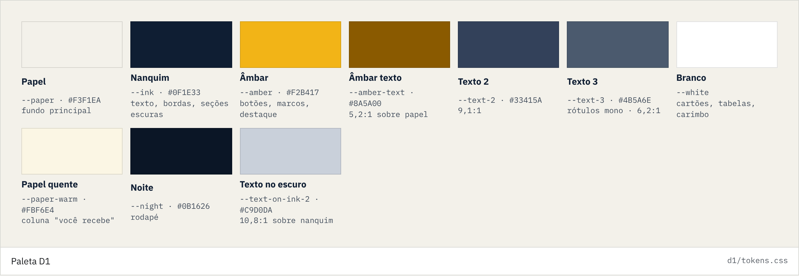

| Token | Hex | Uso | Contraste |
|---|---|---|---|
| `--paper` | #F3F1EA | fundo principal | — |
| `--ink` | #0F1E33 | texto, bordas fortes, seções escuras, botão escuro | 14,8:1 sobre papel |
| `--amber` | #F2B417 | botão primário, marcos, "folha atual", faixa de emergência | nanquim sobre âmbar 9,0:1 |
| `--amber-text` | #8A5A00 | âmbar como **texto** sobre papel (rótulos 01 · O PROBLEMA) | 5,2:1 |
| `--text-2` | #33415A | corpo secundário | 9,1:1 |
| `--text-3` | #4B5A6E | rótulos mono | 6,2:1 |
| `--white` | #FFFFFF | cartões, tabelas, carimbo | — |
| `--paper-warm` | #FBF6E4 | coluna "você recebe", linha de entrega | — |
| `--night` | #0B1626 | rodapé | — |
| `--text-on-ink-2` | #C9D0DA | corpo sobre nanquim | 10,8:1 |

**Proibido:** âmbar #F2B417 como cor de texto sobre papel (contraste 1,8:1). Use `--amber-text`.

## D1.3 Tipografia

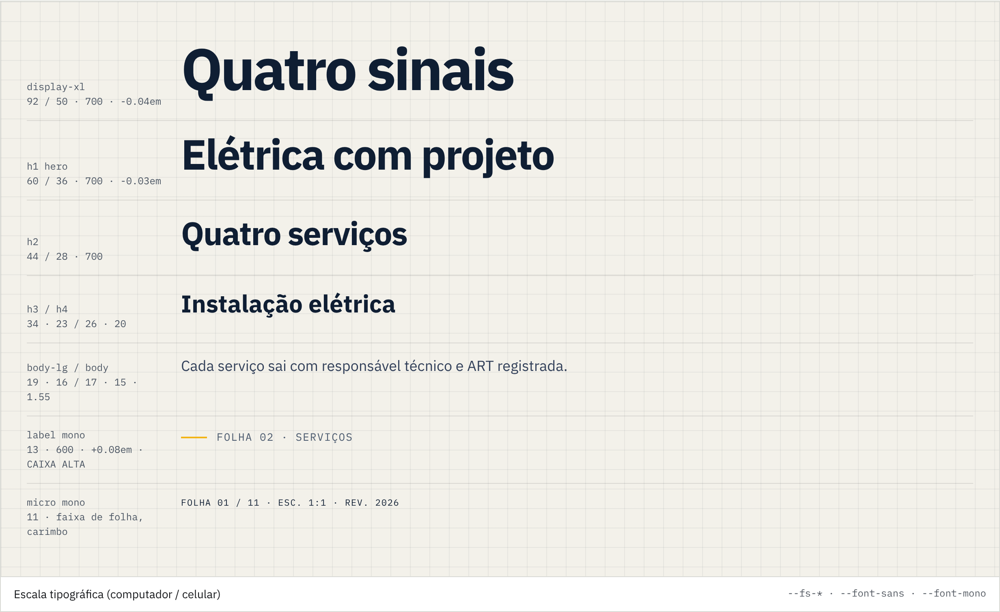

- **IBM Plex Sans** (400, 500, 600, 700): títulos e texto corrido.
- **IBM Plex Mono** (400, 500, 600): rótulos, códigos, cotas, carimbo, faixas de folha.

| Papel | Token | Computador / celular | Peso | Entrelinha | Espaçamento |
|---|---|---|---|---|---|
| Display XL (alertas) | `--fs-display-xl` | 92 / 50 | 700 | 0,98 | −0,04em |
| Display (por que engenheiro) | `--fs-display` | 72 / 38 | 700 | 1,02 | −0,035em |
| H1 (hero) | `--fs-h1` | 60 / 36 | 700 | 1,03 | −0,03em |
| H2 | `--fs-h2` | 44 / 28 | 700 | 1,08 | −0,025em |
| H3 | `--fs-h3` | 34 / 24 | 700 | 1,05 | −0,02em |
| H4 (cards) | `--fs-h4` | 23 / 20 | 700 | 1,2 | 0 |
| Corpo grande | `--fs-body-lg` | 19 / 17 | 400 | 1,55 | 0 |
| Corpo | `--fs-body` | 16 / 15 | 400 | 1,55 | 0 |
| Rótulo mono | `--fs-label` | 13 / 12 | 600 | 1,4 | +0,08em, CAIXA ALTA |
| Micro mono | `--fs-micro` | 11 / 10 | 400–600 | 1,4 | +0,08em, CAIXA ALTA |

Títulos com `text-wrap: balance`. Linhas de corpo com até ~65 caracteres (`max-width: 520px` no hero).

## D1.4 Espaço, grade e layout

- **Escala de espaço (base 4):** 4 · 8 · 12 · 16 · 20 · 24 · 28 · 32 · 40 · 48 · 56 · 64 · 72 · 80 · 96 · 112 · 120 (`--s-*`).
- **Contêiner:** 1200 px, laterais de 32 px no computador e 20 px no celular (`.d1-container`).
- **Malha de fundo:** 24 px no computador e 20 px no celular, linha de 1 px a 6% de nanquim (`.d1-paper`).
- **Altura das seções:** densa 80–96 px de respiro vertical; respiro 112–120 px (`--section-y`, `--section-y-air`). No celular, 44–64 px.
- **Grades principais:** hero 2 colunas (texto | foto com carimbo), mínimo de 460 px por coluna; índice de serviços 4 colunas de 260 px mínimo; detalhes em pares.
- **Faixa de folha:** primeira coisa de cada seção, 20 px abaixo do topo, linha inferior de 1 px.

## D1.5 Forma

| Elemento | Valor |
|---|---|
| Raio | 0 em tudo. Exceção: símbolos circulares (50%). |
| Borda forte | 1,5 px nanquim (`--border`) |
| Borda suave | 1 px `--line` · tracejado interno 1 px `--line-2` |
| Sombra do botão primário | `4px 4px 0 #0F1E33` (sólida, sem desfoque) |
| Sombra do carimbo e das notas | `8px 8px 0 rgba(15,30,51,.12)` |
| Sombra do formulário-carimbo | `12px 12px 0 #F2B417` |

Sombras são sempre **deslocadas e sólidas**, como papel sobre papel. Nunca sombra desfocada.

## D1.6 Ícones e símbolos

- Ícones de traço, 40×40, `stroke-width: 1.6`, cor nanquim, sem preenchimento. Desenhados como símbolos de planta: tomada (círculo + dois traços), planta (retângulo + divisões), medidor (arco + ponteiro), manutenção (seta circular + relógio).
- **Triângulo de atenção:** 64×58, contorno âmbar de 3 px, número em mono 600 dentro.
- **Chamada de detalhe:** círculo de 84 px (60 px no celular) com letra em cima e código embaixo, separados por um traço.
- **Marcadores:** ■ âmbar (#B07A00) para listas; ☐/☑ para "você recebe".

## D1.7 Componentes

> Todos os componentes estão vivos em `referencia/index.html`. As classes estão em `d1/components.css`.

### Botões e links

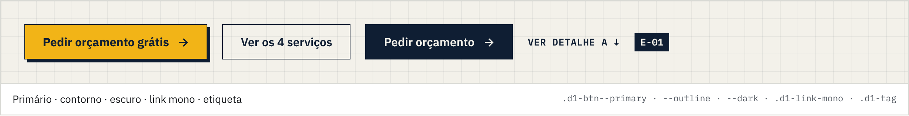

| Variante | Classe | Uso |
|---|---|---|
| Primário | `.d1-btn.d1-btn--primary` | **um por tela**: pedir orçamento |
| Contorno | `.d1-btn.d1-btn--outline` | ação secundária ("Ver os 4 serviços") |
| Escuro | `.d1-btn.d1-btn--dark` | ação sobre fundo âmbar ou claro quando o primário já existe |
| Link mono | `.d1-link-mono` | navegação interna ("VER DETALHE A ↓") |
| Etiqueta | `.d1-tag` | código do serviço (E-01) |

Estados do primário: em repouso tem sombra de 4 px; no hover sobe 2 px com sombra de 6 px; no clique afunda 2 px com sombra de 2 px; no foco, contorno âmbar de 2 px. A altura mínima é 48 px.

```html
<a href="#orcamento" class="d1-btn d1-btn--primary">Pedir orçamento grátis <span aria-hidden="true">→</span></a>
```

### Faixa de folha e cota

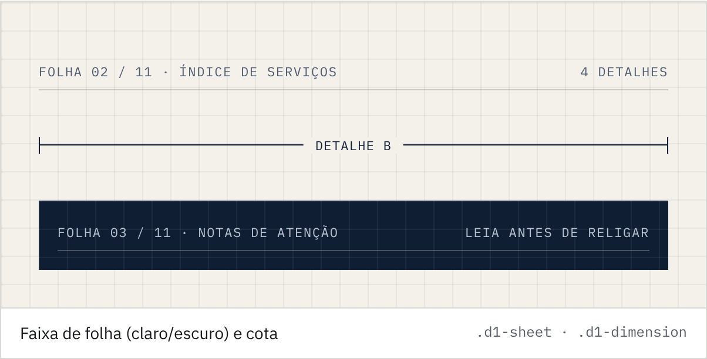

```html
<div class="d1-container"><div class="d1-sheet"><span>FOLHA 04 / 11 · DETALHES A–D</span><span>ESC. 1:10</span></div></div>
<div class="d1-dimension"><span>DETALHE B</span></div>
```

- O texto da direita traz uma informação técnica que faça sentido na seção: escala, número de etapas, revisão.
- A cota separa blocos dentro da mesma folha e nunca substitui a faixa de folha.

### Carimbo (title block)

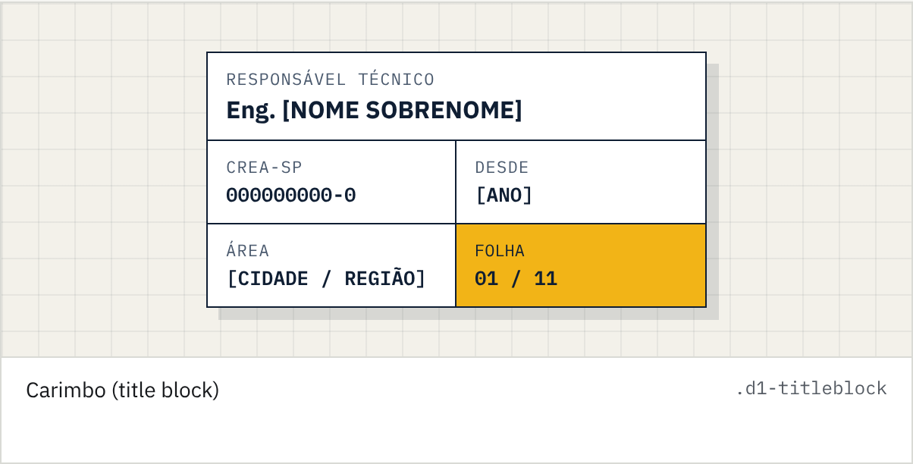

É o elemento-assinatura da D1. Aparece em três lugares: sobre a foto do hero, transformado em formulário (seção 10) e como faixa final no rodapé.

```html
<div class="d1-titleblock" style="width: 330px">
  <div class="d1-titleblock__wide"><span class="d1-titleblock__k">RESPONSÁVEL TÉCNICO</span><span class="d1-titleblock__name">Eng. [NOME SOBRENOME]</span></div>
  <div><span class="d1-titleblock__k">CREA-SP</span><span class="d1-titleblock__v">000000000-0</span></div>
  <div><span class="d1-titleblock__k">DESDE</span><span class="d1-titleblock__v">[ANO]</span></div>
  <div><span class="d1-titleblock__k">ÁREA</span><span class="d1-titleblock__v">[CIDADE / REGIÃO]</span></div>
  <div class="d1-titleblock__accent"><span>FOLHA</span><span class="d1-titleblock__v">01 / 11</span></div>
</div>
```

- **Regra de estrutura:** o primeiro item é sempre o largo (nome); depois vêm pares de células.
- **No hero:** fica em `position: absolute; right: -24px; bottom: -32px` sobre a foto, que tem cotas desenhadas em cima e à esquerda.
- **No celular:** fica abaixo da foto, sobrepondo 40 px, e mostra só nome, CREA e o "desde".

### Índice de serviços

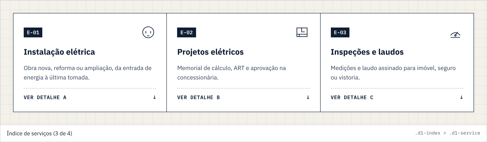

É uma tabela contínua: as bordas são compartilhadas, sem espaço entre os cards. O card inteiro é um link para o seu detalhe. No hover, o fundo vira `--paper-warm`.

```html
<nav class="d1-index" aria-label="Serviços">
  <a href="#det-a" class="d1-service">
    <div class="d1-service__head"><span class="d1-tag">E-01</span><svg …></svg></div>
    <h3 class="d1-service__title">Instalação elétrica</h3>
    <p class="d1-service__text">Obra nova, reforma ou ampliação, da entrada de energia à última tomada.</p>
    <span class="d1-service__more d1-link-mono">Ver detalhe A <span aria-hidden="true">↓</span></span>
  </a>
  <!-- E-02, E-03, E-04 -->
</nav>
```

No celular, o índice vira uma lista de linhas de 64 px (etiqueta + nome + "A ↓"), sem texto descritivo.

### Chamada de detalhe e tabela de detalhe

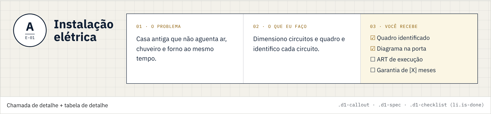

```html
<article id="det-a" class="d1-detail">
  <div style="display:flex;align-items:center;gap:18px">
    <span class="d1-callout"><span class="d1-callout__letter">A</span><span class="d1-callout__ref">E-01</span></span>
    <h3>Instalação<br>elétrica</h3>
  </div>
  <div class="d1-spec">
    <div class="d1-spec__col"><span class="d1-spec__k">01 · O problema</span><p class="d1-spec__v">…</p></div>
    <div class="d1-spec__col"><span class="d1-spec__k">02 · O que eu faço</span><p class="d1-spec__v">…</p></div>
    <div class="d1-spec__col"><span class="d1-spec__k">03 · Você recebe</span>
      <ul class="d1-checklist"><li>Quadro identificado</li><li>Diagrama na porta</li><li>ART de execução</li><li>Garantia de [X] meses</li></ul></div>
  </div>
</article>
```

**Regra de layout da seção 04:**
- **A e B alternam de lado:** em A, título e foto ficam à esquerda e a tabela à direita; em B é o contrário, com um trecho de planta ilustrativo no lugar da foto. Uma cota com o rótulo "DETALHE B" separa os dois.
- **C e D ficam lado a lado, alinhados no topo e com a mesma altura:** C em fundo nanquim, D em branco com borda. Não deslocar o D.

### Nota de atenção e faixa de emergência

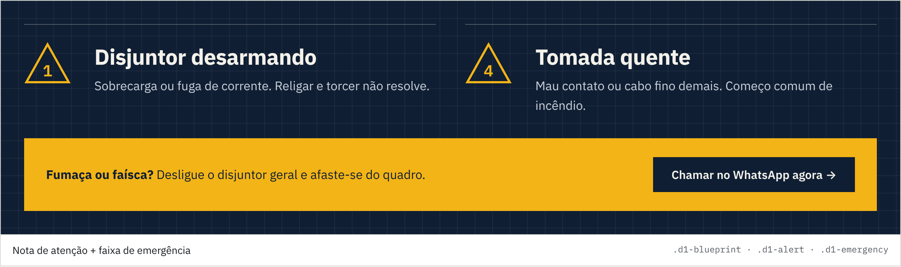

- **Sempre em `.d1-blueprint`** (fundo nanquim com malha clara).
- **Título da seção em escala display XL**, com "não dá" em âmbar.
- **Grade 2×2 no computador e 1 coluna no celular,** com triângulo de 48 px.
- **A faixa de emergência é obrigatória e fica sempre por último na seção.**

### Lista de especificações

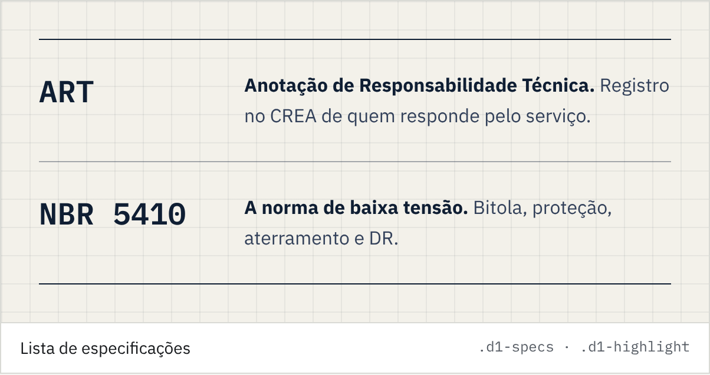

Usada em "Por que um engenheiro": o termo vai em mono de 26 px numa coluna de 150 px, e a definição começa com uma frase em negrito. No celular, vira uma coluna só.

### Marcadores antes/depois

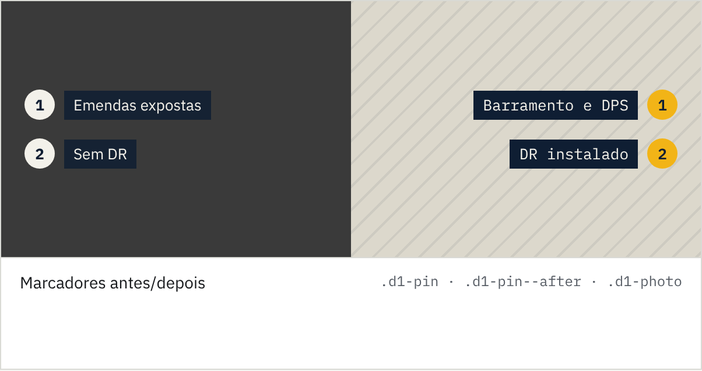

- No "antes", cada marcador tem número branco e rótulo em nanquim translúcido. No "depois", o número fica em âmbar.
- Os mesmos números ligam os dois lados: o 1 do antes corresponde ao 1 do depois.
- Componente de comparação: no computador, um controle deslizante com a linha âmbar e uma alça de 56 px; no celular, abas "Rev. 0 · Antes / Rev. 1 · Depois".

### Régua de trajetória

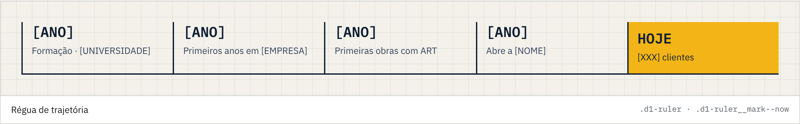

São 5 marcas, e a última ("HOJE") tem fundo âmbar. Abaixo da régua, cotas com "[X] ANOS" entre as marcas. No celular, a régua fica vertical, com borda à esquerda.

### Cronograma de atendimento

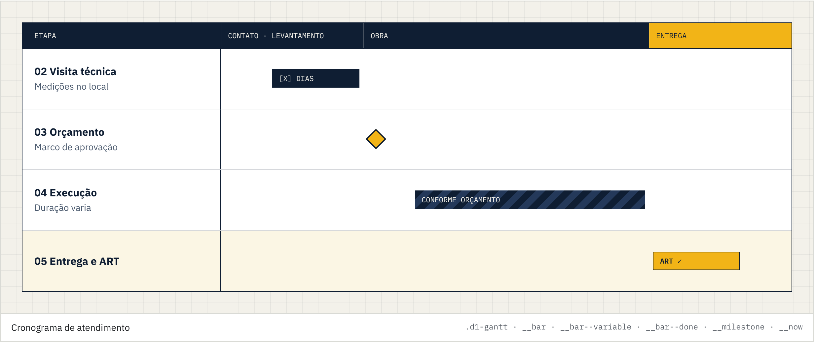

- **Grade:** coluna de etapa com 300 px, mais 12 colunas de tempo.
- **Formas:**
  - barra sólida: etapa com prazo;
  - losango âmbar: marco de aprovação;
  - barra listrada: duração que varia;
  - barra âmbar com borda: entrega.
- **Linha tracejada "VOCÊ ESTÁ AQUI"** no D0, com o botão "Começar pelo D0 →" abaixo.
- **No celular:** cada etapa ganha a sua própria régua de 12 colunas, abaixo do nome.

### Nota de campo e FAQ

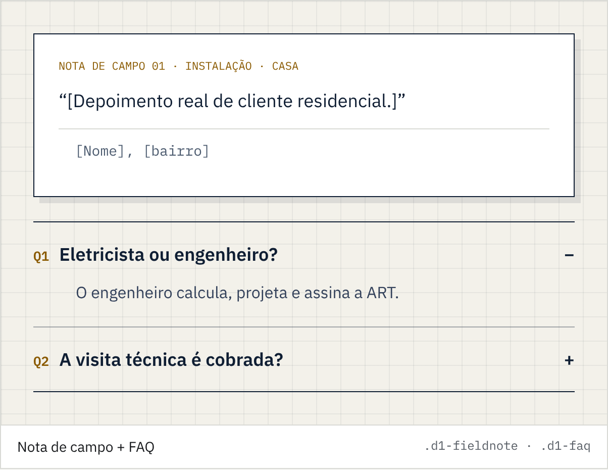

- **As notas de campo ficam levemente desencontradas** (recuos de 0, 48 e 16 px), como notas presas à prancha. É o único lugar da D1 em que o desalinhamento é intencional.
- **FAQ com `<details>`:** a primeira pergunta vem aberta, e cada uma tem um código Q1, Q2… em âmbar-texto.

### Formulário-carimbo

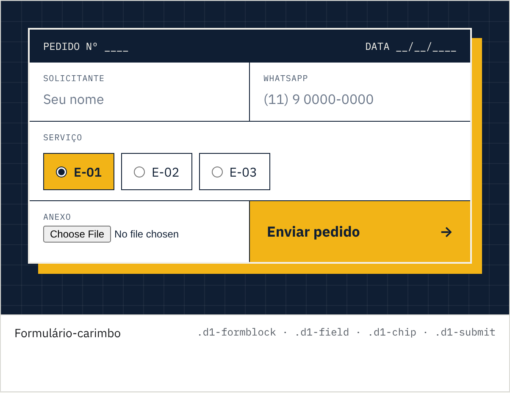

O pedido de orçamento é o carimbo da prancha, preenchível.

- Grade de 4 colunas; cada campo ocupa 2. Os campos de serviço e descrição ocupam a largura toda.
- Os rótulos são mono de 10 px em caixa alta, e o campo não tem borda própria: a borda é a da célula.
- O serviço é escolhido em chips de rádio (`.d1-chip`), e o selecionado fica âmbar.
- O envio é a célula âmbar de 72 px de altura (`.d1-submit`).
- No celular, tudo vira uma coluna.

### Faixa de rodapé

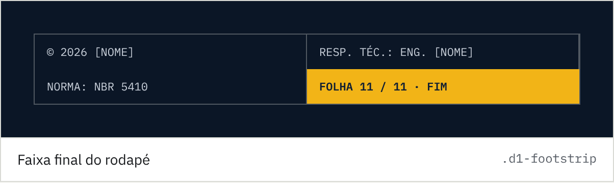

### Foto e anotação

- `.d1-photo`: moldura de 1 px nanquim com hachura diagonal enquanto a foto real não chega.
- `.d1-moment`: anotação roxa tracejada **só no protótipo**. Remova no site final.

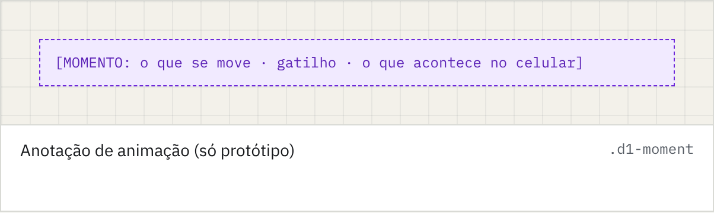

## D1.8 Estrutura da página

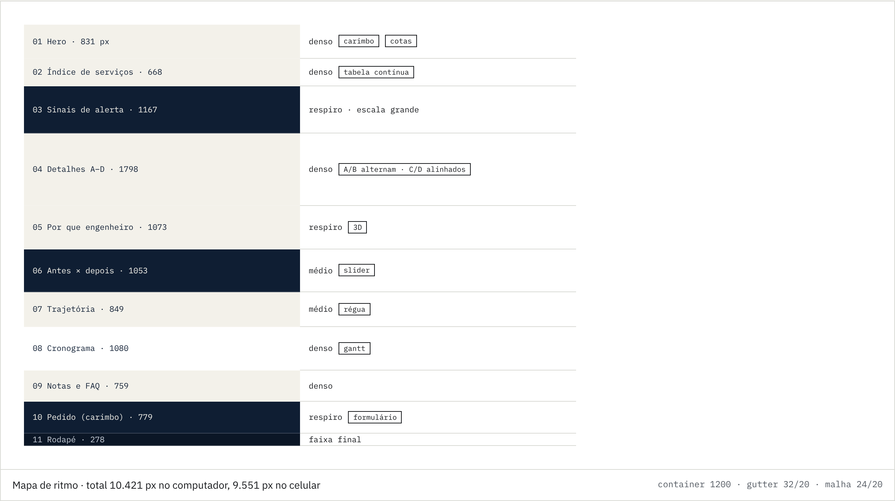

| # | Seção | Fundo | Ritmo | Altura medida (1440) | Componentes | No celular |
|---|---|---|---|---|---|---|
| 01 | Hero | papel + malha | denso | 831 | H1, botões, foto com cotas, carimbo | carimbo abaixo da foto, sem cotas |
| 02 | Índice | papel | denso | 668 | `.d1-index` | lista de linhas |
| 03 | Sinais de alerta | blueprint | **respiro** | 1167 | display XL, `.d1-alert` ×4, `.d1-emergency` | 1 coluna |
| 04 | Detalhes A–D | papel | denso | 1798 | `.d1-callout`, `.d1-spec`, cota | tudo empilhado |
| 05 | Por que engenheiro | papel | **respiro** | 1073 | display, espaço 3D, `.d1-specs` | 3D vira vídeo |
| 06 | Antes × depois | blueprint | médio | 1053 | comparador, `.d1-pin` | abas |
| 07 | Trajetória | papel | médio | 849 | retrato, assinatura, `.d1-ruler` | régua vertical |
| 08 | Cronograma | branco | denso | 1080 | `.d1-gantt` | régua por etapa |
| 09 | Notas e FAQ | papel | denso | 759 | `.d1-fieldnote`, `.d1-faq` | notas em carrossel horizontal |
| 10 | Pedido | blueprint | **respiro** | 779 | `.d1-formblock`, canais | 1 coluna |
| 11 | Rodapé | noite | — | 278 | `.d1-footstrip` | 2 colunas |

Total medido: **10.421 px no computador** e **9.551 px no celular**. A regra de ritmo é nunca empilhar duas seções densas claras sem uma seção escura ou de respiro entre elas, a cada 2 ou 3 seções.

Páginas completas: [computador](img/pagina-D1-computador.png) · [celular](img/pagina-D1-celular.png)

## D1.9 Movimento e interações

**Curvas e durações** (tokens): traço `cubic-bezier(.65,0,.35,1)` em 600 ms; carimbo `cubic-bezier(.2,1.4,.4,1)` em 420 ms; transições rápidas de 150–250 ms; atraso entre itens de 120 ms.

### Interações globais

| Interação | Comportamento | Celular |
|---|---|---|
| Indicador de folha fixo | A faixa "FOLHA 0X / 11" gruda no topo; o número troca ao passar de seção (IntersectionObserver). Clique abre o índice das 11 folhas em miniatura. | Fica no header, só o número |
| Modo cianotipia | Botão no header troca papel por blueprint (fundo nanquim, linhas claras). Transição "revela" de cima para baixo em 600 ms. Guardar a escolha em `localStorage`. | Igual |
| Cursor de CAD | Só no hero: cruz fina com coordenadas X/Y em mono. | Desligado |

### Momentos por seção

| Seção | O que se move | Gatilho | Celular |
|---|---|---|---|
| 01 Hero | Título aparece como linhas de construção a lápis e é "passado a nanquim"; cotas se desenham (0→100%, 600 ms); carimbo bate (escala 1,04→1 com sombra crescendo). Hover no carimbo mostra "verificar CREA". | carregamento | Carimbo sobe de baixo; sem cotas |
| 02 Índice | Hover: a borda do card vira cota com medida; ícone se redesenha. Clique: o círculo de chamada cresce até virar a seção do detalhe. | hover / clique | Toque leva direto ao detalhe |
| 03 Alertas | Triângulos acendem em âmbar, um por vez (120 ms); título cresce de 0,96 para 1. Hover mostra corte técnico do problema. Botão "Isso está acontecendo agora" abre WhatsApp com mensagem pronta. | seção 30% visível | Triângulos acendem ao rolar |
| 04 Detalhes | Lista "você recebe" se marca sozinha (☐→☑) com traço de caneta. No detalhe B, o trecho âmbar percorre a planta. | rolagem | Igual |
| 05 Engenheiro | **3D:** ver D1.10. Controle "no olho ↔ calculado" endireita as linhas tortas. | rolagem (scrub) | Vídeo de 6 s em loop |
| 06 Antes/depois | A linha desliza sozinha 50→20→80→50% uma vez, para ensinar o gesto. Nuvens de revisão envolvem os problemas do "antes"; no "depois" viram ✓. | seção visível | Abas com fade de 250 ms |
| 07 Trajetória | A assinatura se escreve sozinha; régua arrastável; cotas contam. | seção visível | Assinatura se escreve |
| 08 Cronograma | Barras crescem da esquerda para a direita (150 ms entre linhas); losango "carimba". Seletor de serviço reorganiza as barras. | tabela 40% visível | Cada barra cresce na sua linha |
| 09 Notas/FAQ | Notas se endireitam no hover; FAQ abre como nota numerada. | hover / clique | — |
| 10 Pedido | Cada campo preenchido ganha um traço de nanquim. **Ao enviar:** carimbo "RECEBIDO" com data bate na folha e a prancha se dobra no formato de arquivo (A4). | digitação / envio | Igual, dobra simplificada |
| 11 Rodapé | Link "imprimir esta prancha" gera PDF diagramado como prancha. | clique | — |

## D1.10 Espaços 3D e vídeo

| ID | Onde | O que é | Celular |
|---|---|---|---|
| D1-3D-01 | Seção 05 | Casa em wireframe isométrico; paredes se afastam, eletrodutos aparecem, circuitos acendem em âmbar a partir do quadro, rótulos de cálculo flutuam | vídeo em loop |
| D1-3D-02 (opcional) | Seção 06 | Quadro elétrico que passa de wireframe a sólido | imagem |
| D1-V-01 | Fundo seção 05 / transição 04→05 | A planta com a energia percorrendo os circuitos | igual, versão vertical |
| D1-V-02 a 06 | ver o guia de produção | plotter, lápis→nanquim, cota viva, caneta real, malha que respira | — |

Briefings e prompts completos em `PRODUCAO-VIDEO-3D.md`.

## D1.11 Fotografia

- **Linha:** documental, luz natural fria, pontos âmbar. Nada posado.
- **Lista mínima:** retrato do engenheiro de três quartos com uma planta na mão; mãos com caneta técnica sobre papel vegetal; alicate amperímetro e multímetro com o número legível; quadro aberto organizado e etiquetado (para o "depois"); quadro desorganizado de um cliente, com autorização (para o "antes"); imagens térmicas reais.
- **Tratamento:** duotone nanquim (#0F1E33 → #F3F1EA), grão leve e, quando fizer sentido, cotas desenhadas por cima.
- **Proporções:** hero 4:5 (500 px de altura); detalhes 16:10; antes/depois 4:3; retrato 1:1 ou 4:5.

## D1.12 Pendências conhecidas

- O tracejado "VOCÊ ESTÁ AQUI" do cronograma passa por cima da barra D0. Mover a linha 12 px para a direita ou colocar a barra D0 depois da linha.

---

# D3 · Unifilar

## D3.1 Conceito e regras de ouro

A página é um **diagrama unifilar vivo**. Uma linha de cobre de 3 px desce do hero ao rodapé, sempre na mesma posição horizontal. Cada seção é um nó dessa linha; os serviços são circuitos (C1–C4) com disjuntores que **fecham** quando o circuito "liga". A página termina no **símbolo de aterramento**.

1. **O tronco nunca se interrompe e nunca muda de posição.** Seções novas entram dentro de `.d3-trunk`.
2. **Disjuntor fechado = ligado (ON); aberto = desligado (OFF).** Nunca desenhar aberto um serviço que está "ligado".
3. **Cobre é o único acento.** Petróleo e papel se alternam entre as seções.
4. **Títulos sempre em Archivo com largura 125% e peso 900.** É a voz da marca.
5. **Códigos de circuito em tudo:** C1–C4 nos serviços, F1–F4 nas faltas. O formulário usa os mesmos códigos.

## D3.2 Cores

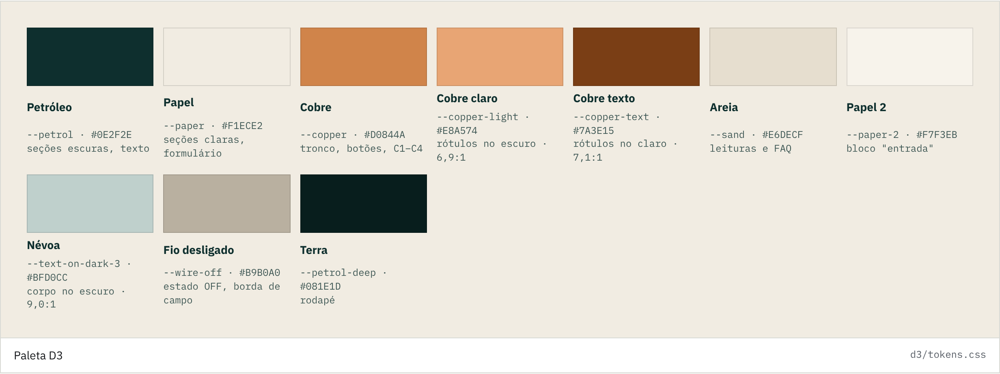

| Token | Hex | Uso | Contraste |
|---|---|---|---|
| `--petrol` | #0E2F2E | seções escuras, texto sobre papel, botão escuro | 12,2:1 com papel |
| `--paper` | #F1ECE2 | seções claras, formulário | — |
| `--copper` | #D0844A | tronco, botões, números C1–C4, sombra do formulário | 4,8:1 com petróleo |
| `--copper-light` | #E8A574 | rótulos mono sobre petróleo | 6,9:1 |
| `--copper-text` | #7A3E15 | cobre como texto sobre papel | 7,1:1 |
| `--sand` | #E6DECF | seção de leituras e FAQ | — |
| `--paper-2` | #F7F3EB | bloco "entrada" do circuito | — |
| `--text-2` | #2F4644 | corpo secundário sobre papel | 8,6:1 |
| `--text-on-dark-3` | #BFD0CC | corpo secundário sobre petróleo | 9,0:1 |
| `--wire-off` | #B9B0A0 | fio desligado, borda de campo | — |
| `--petrol-deep` | #081E1D | rodapé | — |

**Proibido:** cobre #D0844A como texto pequeno sobre papel (3,0:1). Use `--copper-text`. Os números grandes C1–C4 em cobre sobre papel são aceitos por serem texto grande (34 px ou mais, peso 900).

## D3.3 Tipografia

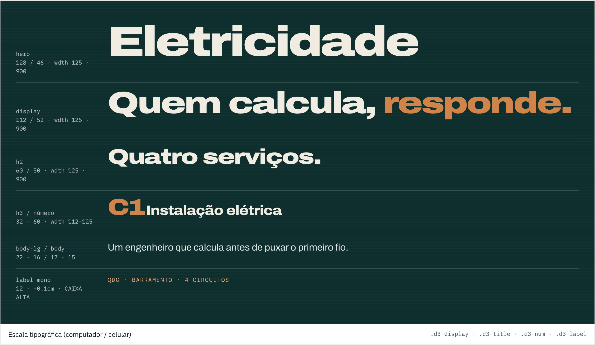

- **Archivo** (variável, eixo de largura 62–125 e peso 300–900). Carregar com `family=Archivo:wdth,wght@62..125,300..900`.
- **DM Mono** (400, 500) para códigos, rótulos e números de registro.

| Papel | Token | Computador / celular | Largura | Peso | Entrelinha | Espaçamento |
|---|---|---|---|---|---|---|
| Hero | `--fs-hero` | 128 / 46 | 125% | 900 | 0,9 | −0,035em |
| Display | `--fs-display` | 112 / 52 | 125% | 900 | 0,86 | −0,045em |
| H2 | `--fs-h2` | 60 / 30 | 125% | 900 | 0,95 | −0,03em |
| H3 | `--fs-h3` | 32 / 21 | 112% | 800 | 1,05 | −0,02em |
| Número de circuito | `--fs-num` | 60 / 26 | 125% | 900 | 0,85 | −0,04em |
| Corpo grande | `--fs-body-lg` | 22 / 17 | 100% | 400 | 1,5 | 0 |
| Corpo | `--fs-body` | 16 / 15 | 100% | 400 | 1,55 | 0 |
| Rótulo mono | `--fs-label` | 12 / 10 | — | 400–500 | 1,4 | +0,1em, CAIXA ALTA |

Em CSS: `font-stretch: 125%` (classe `.d3-display`). Se a fonte variável não carregar, o navegador usa a largura normal, e o layout continua funcionando.

## D3.4 Espaço, grade e layout

- **Escala de espaço (base 4):** 4 · 8 · 12 · 16 · 20 · 24 · 32 · 40 · 48 · 56 · 64 · 72 · 80 · 96 · 104 · 112 · 136.
- **Contêiner:** 1280 px, laterais de 48 px no computador e 20 px no celular.
- **Tronco:** borda esquerda de 3 px; o conteúdo fica 64 px à direita (22 px no celular), pelo token `--trunk-pad`.
- **Altura das seções:** densa 96–104 px de respiro vertical; respiro 128–136 px. No celular, 48–64 px.
- **Grades principais:** hero 2 colunas (texto | formulário) de no mínimo 440 px; barramento e circuitos com 4 colunas de no mínimo 240–260 px; faltas 2×2; legenda 96 | 200 | 1fr.

## D3.5 Forma

| Elemento | Valor |
|---|---|
| Raio | 0. Exceção: nós e símbolos circulares. |
| Tronco, derivação, barramento | 3 px cobre |
| Borda do circuito ligado | 2 px cobre; desligado: 2 px petróleo a 25% e opacidade 0,72 |
| Sombra do formulário | `14px 14px 0 #D0844A` (8 px no celular) |
| Divisões no escuro | 1 px papel a 25% |

## D3.6 Símbolos

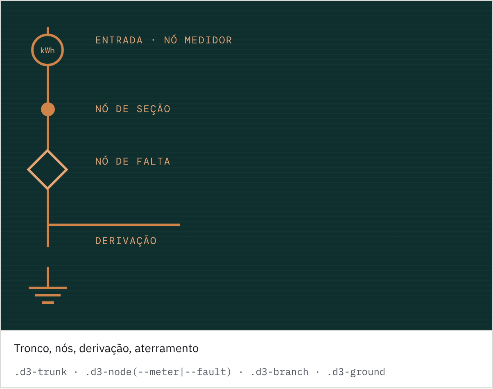
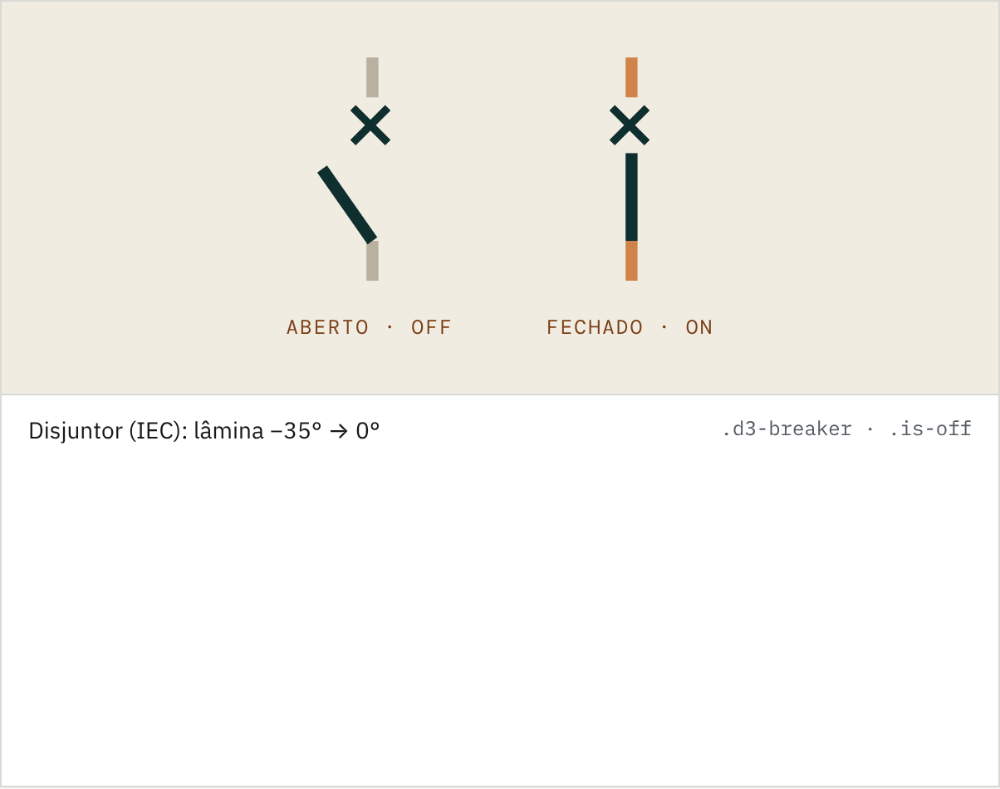

| Símbolo | Classe | Uso |
|---|---|---|
| Nó medidor (kWh) | `.d3-node--meter` | início do tronco, no hero |
| Nó de seção | `.d3-node` | início das seções claras |
| Nó de falta (losango) | `.d3-node--fault` | seção de alertas |
| Derivação | `.d3-branch` | ligação horizontal do tronco a um card |
| Barramento | `.d3-bus` | linha horizontal sobre os 4 serviços e sobre a sequência |
| Disjuntor (IEC) | `.d3-breaker` / `.is-off` | serviços, circuitos, sequência, FAQ |
| Aterramento | `.d3-ground` | fim da página |

**Disjuntor:** é feito de fio de entrada (10 px), um "X" de 12 px, a lâmina (22 px) e o fio de saída (10 px).
- Fechado: lâmina a 0° e fio em cobre.
- Aberto: lâmina a −35° e fio em `--wire-off`.
- A transição dura 250 ms com `cubic-bezier(.3,1.6,.5,1)`, que tem um pequeno "pulo" no fim, como o clique real.

```html
<span class="d3-breaker is-off">
  <i></i>
  <svg width="12" height="12" viewBox="0 0 16 16" aria-hidden="true"><path d="M3 3l10 10M13 3L3 13" stroke="#0E2F2E" stroke-width="2.4"/></svg>
  <b></b>
  <i></i>
</span>
```

Ícones da legenda: traço de 2,5 px em cobre, 56×56: documento (ART), livro (NBR 5410), selo (CREA), sigma (cálculo).

## D3.7 Componentes

> Todos estão vivos em `referencia/index.html` (o circuito é clicável). As classes estão em `d3/components.css`.

### Botões e links

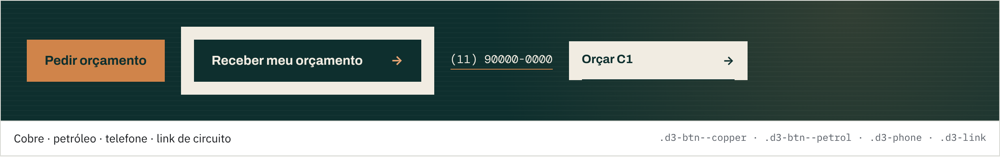

| Variante | Classe | Uso |
|---|---|---|
| Cobre | `.d3-btn.d3-btn--copper` | pedir orçamento no header, sobre petróleo |
| Petróleo | `.d3-btn.d3-btn--petrol` | envio dos formulários, botão sobre cobre (emergência) |
| Telefone | `.d3-phone` | header e contato, sublinhado em cobre |
| Link de circuito | `.d3-link` | "Orçar C1 →" no fim de cada card |

Altura mínima de 52 px. O texto do botão petróleo termina com uma seta em `--copper-light`.

### Barramento de serviços (seção 02)

- Linha de barramento (`.d3-bus`) com um ponto no fim; de cada derivação desce um disjuntor e, embaixo dele, o card.
- O card começa com uma borda superior de 3 px em petróleo, número C1–C4 grande em cobre, selo "FECHADO · ON", título, uma frase e o link "Ver circuito C1 ↓".
- Na entrada da seção, os quatro disjuntores fecham em sequência.

### Card de circuito (seção 04, interativo)

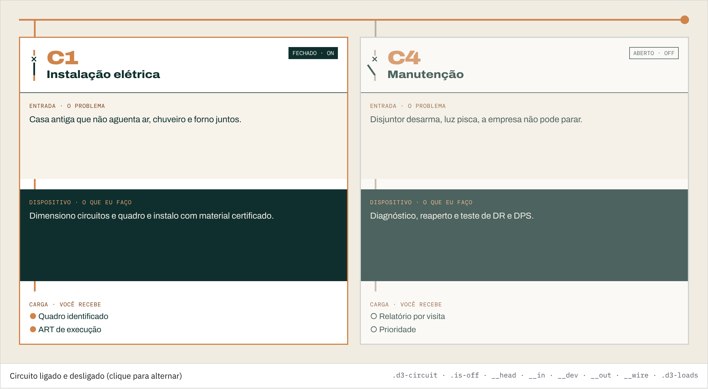

**Estrutura idêntica nos quatro, sempre:**

```html
<div class="d3-services" data-circuits>
  <div style="display:flex;flex-direction:column">
    <div class="d3-circuit__wire" style="height:28px;margin-left:26px"></div>  <!-- derivação do barramento -->
    <article id="c1" class="d3-circuit">
      <button type="button" class="d3-circuit__head" aria-pressed="true">
        <span class="d3-breaker">…</span>
        <span class="d3-circuit__name"><span class="d3-num" style="font-size:34px">C1</span><span class="d3-circuit__title">Instalação elétrica</span></span>
        <span class="d3-circuit__state">FECHADO · ON</span>
      </button>
      <div class="d3-circuit__block d3-circuit__in"><span class="d3-circuit__k">Entrada · o problema</span><p>…</p></div>
      <div class="d3-circuit__wire"></div>
      <div class="d3-circuit__block d3-circuit__dev"><span class="d3-circuit__k">Dispositivo · o que eu faço</span><p>…</p></div>
      <div class="d3-circuit__wire"></div>
      <div class="d3-circuit__block d3-circuit__out"><span class="d3-circuit__k">Carga · você recebe</span><ul class="d3-loads"><li>…</li></ul></div>
      <a href="#orcamento" class="d3-link">Orçar C1 <span aria-hidden="true">→</span></a>
    </article>
  </div>
  <!-- c2, c3, c4 com class="d3-circuit is-off" -->
</div>
```

**Alturas mínimas fixas**, para os blocos se alinharem mesmo quando um título ocupa uma linha só ("Manutenção"):
- cabeçalho: 96 px (72 px no celular);
- entrada: 150 px (92 px no celular);
- dispositivo: 160 px (92 px no celular).

**Interação:** um circuito ligado por vez, e o C1 começa ligado.
- Clicar no cabeçalho liga aquele circuito: o disjuntor fecha, os fios acendem, as cargas viram ●, o selo muda para "FECHADO · ON" e o formulário de contato passa a vir com esse circuito selecionado.
- Os outros três desligam e ficam com opacidade 0,72.

```js
document.querySelectorAll('[data-circuits]').forEach(group => {
  group.addEventListener('click', e => {
    const head = e.target.closest('.d3-circuit__head'); if (!head) return;
    group.querySelectorAll('.d3-circuit').forEach(c => {
      const on = c.contains(head);
      c.classList.toggle('is-off', !on);
      c.querySelector('.d3-breaker').classList.toggle('is-off', !on);
      c.querySelector('.d3-circuit__head').setAttribute('aria-pressed', String(on));
      c.querySelector('.d3-circuit__state').textContent = on ? 'FECHADO · ON' : 'ABERTO · OFF';
      if (on) document.querySelector(`input[name="circuito"][value="${c.id.toUpperCase()}"]`)?.click();
    });
  });
});
```

### Faltas e faixa de emergência

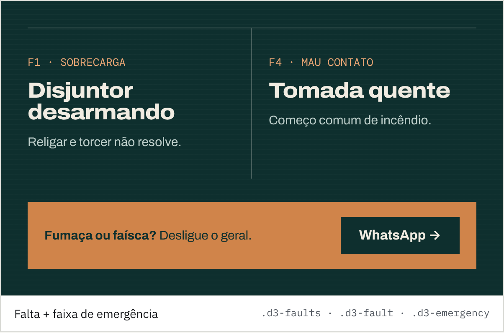

- **Seção escura**, com o nó de falta (losango) no tronco e o título em display ("Quando a casa dá sinal.").
- **Grade 2×2** com divisões finas, código F1–F4 em mono cobre-claro e título em largura 112%.
- **A faixa de emergência em cobre é obrigatória**, com o botão petróleo para o WhatsApp.

### Legenda (por que um engenheiro)

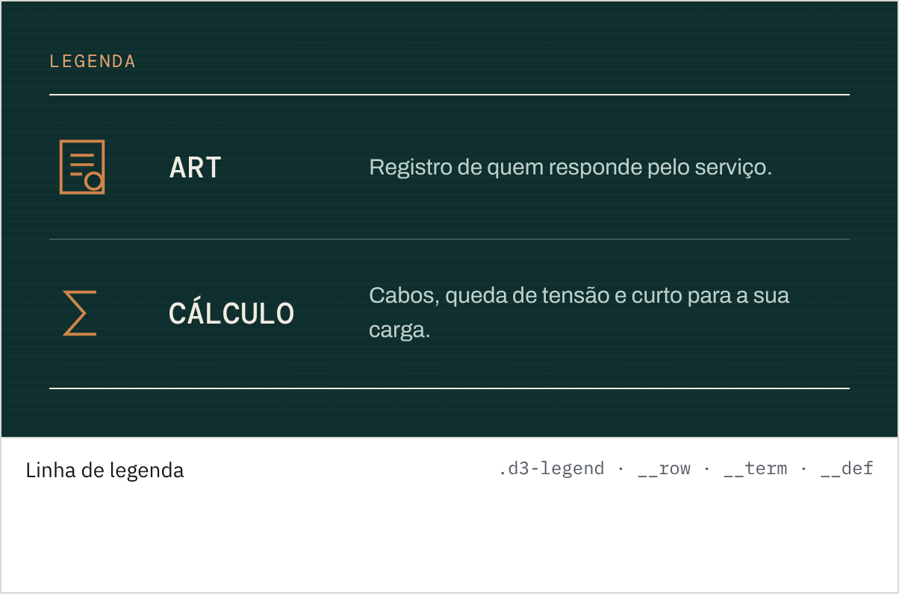

Organizada como a legenda de um diagrama, com três colunas: símbolo, termo em mono e definição. O título vem em escala display ("Quem calcula, responde.").

### Leituras de campo (depoimentos)

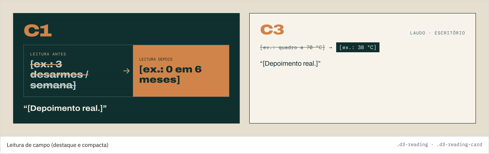

- **Cada depoimento traz a leitura do circuito contratado,** com o código C1–C4.
- **A leitura "antes" vem riscada em cobre-claro** e a "depois" num bloco cobre, com números tabulares.
- **Uma leitura de destaque** em fundo escuro, ligada ao tronco por uma derivação, e duas compactas em cartões claros.
- **Sem medição real, não publicar a leitura.** O depoimento pode aparecer sem ela.

### FAQ com mini-disjuntor

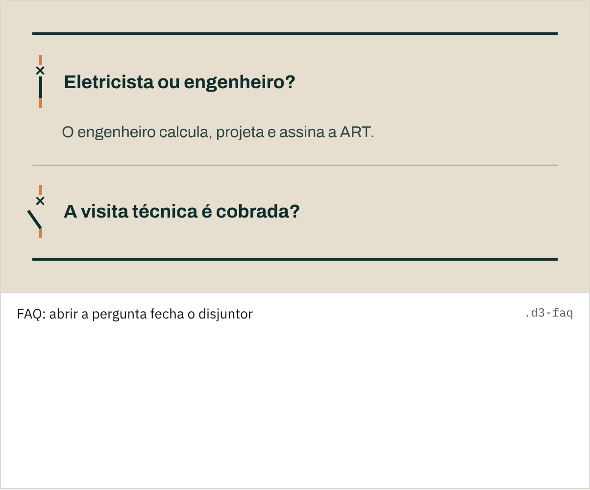

Abrir a pergunta fecha o disjuntor ao lado dela. É feito só com CSS, pela regra `details:not([open]) .d3-breaker`.

### Formulário "carga final"

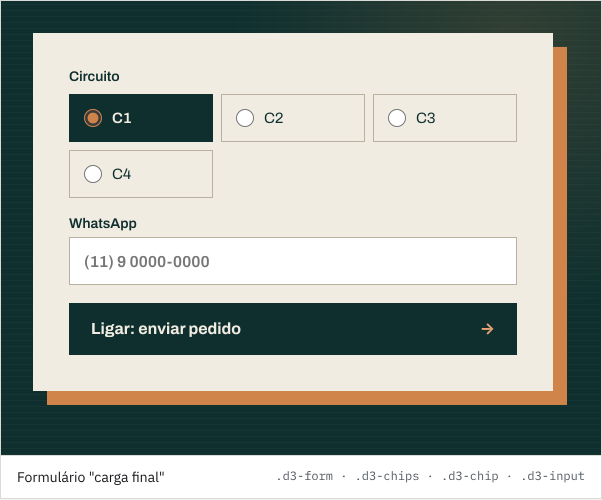

- Escolha do serviço em chips de rádio com os códigos C1–C4; o selecionado fica petróleo.
- Campos com 48 px de altura e borda de 1,5 px em `--wire-off`; no foco, a borda fica cobre com um halo de 3 px.
- Envio no botão petróleo "Ligar: enviar pedido →".
- No hero existe uma versão curta (circuito, nome, WhatsApp). A versão completa, na seção 10, acrescenta e-mail, tipo de imóvel, descrição e fotos.

### Sequência de manobra (como funciona)

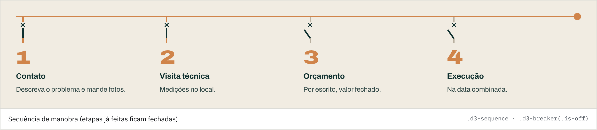

- Um barramento com 5 disjuntores: as etapas já percorridas ficam fechadas e as próximas, abertas.
- A última etapa é "ART", com o fundo do número em cobre.

### Anotação

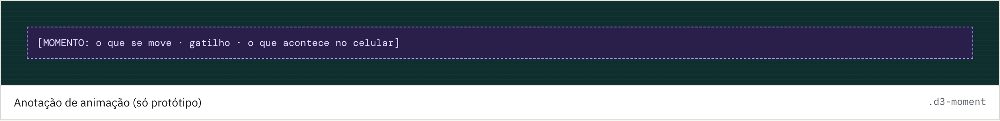

Só no protótipo. Remova no site final.

## D3.8 Estrutura da página

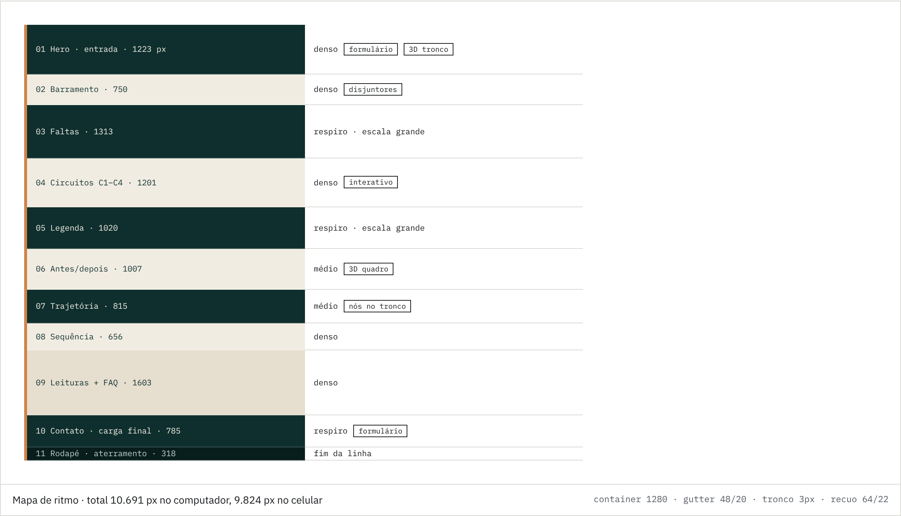

| # | Seção | Fundo | Ritmo | Altura medida (1440) | Componentes | No celular |
|---|---|---|---|---|---|---|
| 01 | Hero · entrada | petróleo + brilho cobre | denso | 1223 | hero, nó kWh, formulário curto, espaço 3D | form abaixo do texto |
| 02 | Barramento | papel | denso | 750 | `.d3-bus`, 4 serviços com disjuntor | lista na linha do tronco |
| 03 | Faltas | petróleo | **respiro** | 1313 | display, `.d3-faults`, `.d3-emergency` | 1 coluna |
| 04 | Circuitos C1–C4 | papel | denso | 1201 | `.d3-circuit` ×4, interativo | empilhados, mesma interação |
| 05 | Legenda | petróleo | **respiro** | 1020 | display, `.d3-legend` | 2 colunas |
| 06 | Antes/depois | papel | médio | 1007 | comparador, espaço 3D do quadro | abas + imagem |
| 07 | Trajetória | petróleo | médio | 815 | nós de ano no tronco, retrato | igual |
| 08 | Sequência | papel | denso | 656 | `.d3-sequence` | lista vertical |
| 09 | Leituras + FAQ | areia | denso | 1603 | `.d3-reading`, `.d3-faq` | empilhado |
| 10 | Contato | petróleo + brilho | **respiro** | 785 | formulário completo, canais | 1 coluna |
| 11 | Rodapé | terra | — | 318 | `.d3-ground` | igual |

Total medido: **10.691 px no computador** e **9.824 px no celular**.

Páginas completas: [computador](img/pagina-D3-computador.png) · [celular](img/pagina-D3-celular.png)

## D3.9 Movimento e interações

**Curvas e durações:** a lâmina do disjuntor usa `cubic-bezier(.3,1.6,.5,1)` em 250 ms; o fluxo de corrente usa `cubic-bezier(.4,0,.2,1)` em 800 ms; o atraso entre itens é de 150 ms.

### Interações globais

| Interação | Comportamento | Celular |
|---|---|---|
| Tronco como barra de progresso | Um brilho cobre desce pela linha até a posição da rolagem; cada nó é clicável e leva à seção. | Pulso de luz 2D |
| Cursor de corrente | Ponto de luz cobre com rastro curto (canvas 2D). | Desligado |
| Som do disjuntor | Clique de disjuntor ao ligar circuitos. **Desligado por padrão**, com botão de som no header. | Igual |

### Momentos por seção

| Seção | O que se move | Gatilho | Celular |
|---|---|---|---|
| 01 Hero | Título "acende" como filamento (tremor de luz, uma vez); o disco do medidor gira conforme a rolagem; escolher um circuito no formulário acende o ramal até o card. **3D:** tronco de cobre. | carregamento / rolagem | Sem 3D; pulso 2D |
| 02 Barramento | Disjuntores fecham C1→C4 (150 ms entre eles); o trecho abaixo acende; o selo vira ON. | barramento entra na tela | Cada um ao cruzar o meio da tela |
| 03 Faltas | O tronco "pisca" instável no losango e estabiliza. Botão "Simular falta" faz um disjuntor desarmar com tranco. Microanimações: fumaça (F2), distorção de calor (F4), faísca (F1). | seção 30% visível / clique | Só o piscar |
| 04 Circuitos | Clique liga o circuito (ver D3.7). As cargas acendem uma a uma. | clique | Toque |
| 05 Legenda | Símbolos se desenham; o hover num termo faz pulsar em cobre todos os lugares da página onde ele aparece. | rolagem / hover | Só o desenho |
| 06 Antes/depois | **3D:** o quadro gira, abre em vista explodida e os disjuntores fecham. O botão "Religar" dispara a sequência. | arraste / rolagem / clique | Imagem + abas |
| 07 Trajetória | Os nós de ano acendem; a linha engrossa a cada ano. | rolagem | Igual |
| 08 Sequência | Os 5 disjuntores fecham conforme a rolagem; no último, "LIGADO" pulsa uma vez. | rolagem (scrub) | Cada etapa ao cruzar o meio |
| 09 Leituras/FAQ | O "antes" recebe o risco; o "depois" conta até o valor (visor de 7 segmentos, 800 ms). Abrir uma pergunta fecha o mini-disjuntor. | entrada na tela / clique | Igual |
| 10 Contato | Cada campo preenchido fecha um trecho do circuito até o botão. **Opcional:** o envio por um disjuntor grande que se empurra para cima, sempre com botão comum ao lado. Ao enviar, um flash de corrente percorre o tronco até o hero. | digitação / envio | Botão comum |
| 11 Rodapé | Pulsos lentos descem até o símbolo de terra. | contínuo | Igual |

## D3.10 Espaços 3D e vídeo

| ID | Onde | O que é | Celular |
|---|---|---|---|
| D3-3D-01 | Página inteira (hero → rodapé) | Tronco de cobre 3D com partículas de corrente que reagem à rolagem | linha 2D com pulso |
| D3-3D-02 | Seção 06 | Quadro de distribuição 3D: gira, explode, disjuntores fecham, pontos clicáveis | imagem explodida |
| D3-3D-03 (bônus) | Fundo do hero | Corte de cabo em macro, fios de cobre trançados girando | vídeo |
| D3-V-01 a 07 | ver o guia de produção | diagrama que liga, o clique, cobre desencapado, senoide, lâmpada, termografia, aterramento | — |

Briefings e prompts completos em `PRODUCAO-VIDEO-3D.md`.

## D3.11 Fotografia

- **Linha:** editorial e dramática, com luz baixa e lateral, sombras verdes e brilhos de cobre.
- **Lista mínima:**
  - **a mão fechando um disjuntor**, a foto-símbolo da direção;
  - retrato de perfil com luz lateral quente;
  - macros de cobre desencapado, bornes e fileiras de disjuntores em foco raso;
  - comércios e casas atendidos ao entardecer, com as luzes acesas;
  - imagens térmicas reais (para as leituras de campo).
- **Tratamento:** duotone petróleo (#0E2F2E) com altas luzes cobre (#D0844A) e grão de filme.
- **Proporções:** retrato 4:5 (480 px de altura no computador); comparador 4:3; macros 16:9 para fundos.

## D3.12 Pendências conhecidas

- No protótipo do canvas, o cabeçalho dos circuitos tem `min-height: 84px`, e o C4 ("Manutenção", em uma linha) fica mais baixo que os outros. No CSS deste pacote, o valor já está corrigido para 96 px. Ao implementar, use as classes, não o protótipo.

---

## 5. Prompts prontos para o Claude Code

Copie, troque o que está entre `< >` e cole no Claude Code dentro do projeto.

**Criar o esqueleto da página**
```
Leia design-system/DESIGN-SYSTEM.md (capítulos 1, 2 e a direção <D3>). Crie index.html com as 11 seções na ordem do capítulo 2.1, usando somente as classes de design-system/<d3>/components.css e os tokens de design-system/<d3>/tokens.css. Use os textos do capítulo 2 e mantenha todos os placeholders entre colchetes. Não implemente animações ainda. Ao final, liste as seções criadas e os componentes usados em cada uma.
```

**Implementar uma seção específica**
```
Implemente a seção <04 Circuitos C1–C4> da direção <D3> seguindo D3.7 e D3.8 do design system, incluindo a interação descrita (um circuito ligado por vez, C1 começa ligado) e a versão de celular. Compare o resultado com design-system/img/<d3-circuito.png>.
```

**Implementar um momento de animação**
```
Implemente o momento da seção <02 Barramento> descrito na tabela D3.9: <disjuntores fecham C1→C4 com 150 ms de atraso quando o barramento entra na tela>. Use IntersectionObserver, os tokens --t-switch e --ease-switch, respeite prefers-reduced-motion e remova a anotação [MOMENTO] do HTML.
```

**Ajustar um token**
```
Troque o token <--copper> para <#C97A3F> em design-system/<d3>/tokens.css. Verifique, em todas as combinações de texto/fundo listadas na tabela D3.2, se o contraste continua acima de 4,5:1 (ou 3:1 para texto grande) e me diga quais pares falham.
```

**Criar um componente novo**
```
Preciso de um componente <selo de garantia> na direção <D1>. Antes de criar, verifique se algum componente do capítulo D1.7 resolve. Se não, crie .d1-<nome> em d1/components.css usando somente tokens, siga as regras de ouro D1.1 e adicione uma seção ao DESIGN-SYSTEM.md com imagem, classe, uso e um exemplo de HTML.
```

**Remover uma seção**
```
Remova a seção <06 Antes e depois> da página. Mantenha a numeração das folhas coerente (D1: renumere "FOLHA 0X / 11" para o novo total) e o ritmo claro/escuro do capítulo <D1.8>. Me diga se duas seções densas ficaram vizinhas.
```

**Revisar antes de publicar**
```
Revise index.html contra o DESIGN-SYSTEM.md: cores fora dos tokens, cantos arredondados, mais de um botão primário por tela, anotações [MOMENTO] esquecidas, placeholders sem preencher, contraste abaixo de 4,5:1, alvos de toque menores que 44 px e animações que ignoram prefers-reduced-motion. Liste os problemas por seção.
```

---

## 6. Glossário técnico

| Termo | O que é |
|---|---|
| ART | Anotação de Responsabilidade Técnica: registro no CREA que identifica o profissional responsável por um serviço. |
| CREA | Conselho Regional de Engenharia e Agronomia; o número de registro do engenheiro é público e verificável. |
| NBR 5410 | Norma brasileira de instalações elétricas de baixa tensão. |
| DR | Dispositivo diferencial residual: desliga o circuito quando há fuga de corrente (protege contra choque). |
| DPS | Dispositivo de proteção contra surtos. |
| SPDA | Sistema de proteção contra descargas atmosféricas (para-raios). |
| QDG / QDC | Quadro de distribuição geral / de circuitos. |
| Unifilar | Diagrama elétrico que representa cada circuito por uma única linha. |
| Termografia | Imagem térmica que mostra pontos de aquecimento anormal. |
| Carimbo | Bloco de identificação no canto da prancha técnica (responsável, registro, folha, escala, revisão). |
| Cota | Linha de dimensão de um desenho técnico. |
| Nuvem de revisão | Contorno ondulado usado para marcar o que mudou entre revisões de uma prancha. |
